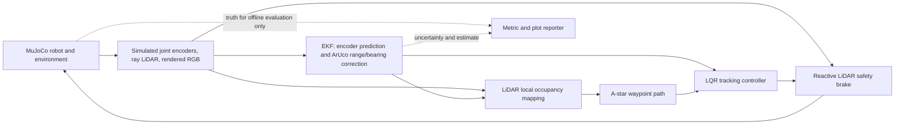

# TurtleBot3 Visual Waypoint Navigation & Docking

**UTS 42043 / 41014 — Integrated Project, Track A — 2026**

> **Status: research/development baseline, not a verified MuJoCo or physical-robot demonstration.**
> The *kinematic test double* and Python unit tests have been executed; **MuJoCo physics, rendered ArUco perception and ROS 2 hardware remain unverified until run in a supported environment**. Do not submit test-double results as MuJoCo evidence.

## GitHub Codespaces and reproducible evidence

Keep this repository private during development. The `.devcontainer/` setup is intended to support **Python and headless MuJoCo rendering in a GitHub Codespace** (OSMesa software rendering); the actual MuJoCo camera, model, and MP4 must still be tested. Work from the repository root. `outputs/` is a disposable scratch directory and is **ignored by Git**, whereas `results/` contains verified, selected run snapshots and is **committed to Git**.

**Verify existing archived evidence:**

```bash
python scripts/verify_archive.py results
python scripts/reproduce_archive.py results/tests/initial_python_tests
python scripts/reproduce_archive.py results/kinematic/nominal_seed7_software_baseline
```

**Run new tests and permanently archive them:**

```bash
python scripts/record_tests.py --out outputs/tests_2026_10_18
python scripts/archive_run.py outputs/tests_2026_10_18 --name tests_2026_10_18
```

**Run and permanently archive a new MuJoCo trial, including rendered video:**

```bash
python -m turtlebot_integrated.cli run --backend mujoco --scenario nominal --seed 7 --video --out outputs/nominal_seed7
python scripts/archive_run.py outputs/nominal_seed7 --name nominal_seed7
python scripts/verify_archive.py results
git add results/
git commit -m "Archive MuJoCo nominal trial and video"
git push
```

Every archive contains a SHA-256 manifest, the input configuration, trial metadata, seed, source Git revision when available, metrics, logs, plots and recorded MP4 when capture succeeded. Reproduce archived MuJoCo runs with `python scripts/reproduce_archive.py results/mujoco/nominal_seed7`, which generates a side-by-side numeric comparison in `outputs/`.

**Existing archived samples are software evidence only:** `results/kinematic/nominal_seed7_software_baseline/` is a low-fidelity test double; `results/tests/initial_python_tests/` contains the Python test-suite report. Neither constitutes a validated MuJoCo demonstration. Read the full workflow, Codespaces warnings and GitHub file-size guidance in [`docs/GITHUB_GUIDE.md`](docs/GITHUB_GUIDE.md) and [`results/README.md`](results/README.md).

## Brief compliance

The integrated project requires TurtleBot3 with **2D LiDAR and camera in MuJoCo**, visual docking to an ArUco charging-station marker, a state-space model, wheel encoder/camera **EKF**, and estimated-state **LQR/state feedback**. All five assessment parts are assessed in simulation. Real hardware is optional and can strengthen HD evidence only after solid simulation results. Submission requires source code, GitHub project page, a five-minute demo, contribution and AI-use declarations, and individual viva.

## System architecture



**Ground-truth rule:** Neither `PoseEKF`, `Navigator`, `OccupancyMap`, nor `LQRTracker` imports or reads simulator truth. The simulation loop reads `sim.get_truth()` only for reports, collisions and success scoring, *after* the control command is generated.

## Installation

Recommended: Linux/Ubuntu with MuJoCo OpenGL/EGL rendering. Needs Python 3.10+ and supported graphics drivers.

```bash
python3 -m venv .venv
source .venv/bin/activate
python -m pip install --upgrade pip
python -m pip install -e ".[test]"
pytest -q
```

Windows PowerShell: replace activation with `.venv\\Scripts\\Activate.ps1`. If MuJoCo renderer fails on headless Linux, run `MUJOCO_GL=egl` with an EGL-compatible GPU, or use a compatible OSMesa build. No graphics backend is guaranteed by this repository.

## Run required MuJoCo simulation

```bash
python -m turtlebot_integrated.cli run --backend mujoco --scenario nominal --video --out outputs/nominal
python -m turtlebot_integrated.cli run --backend mujoco --scenario noise --video --out outputs/noise
python -m turtlebot_integrated.cli run --backend mujoco --scenario blocked --video --out outputs/blocked
python -m turtlebot_integrated.cli run --backend mujoco --scenario disturbance --video --out outputs/disturbance
python -m turtlebot_integrated.cli run --backend mujoco --scenario camera_loss --video --out outputs/camera_loss
python -m turtlebot_integrated.cli suite --backend mujoco --seeds 5 --out outputs/mujoco_suite
```

These commands are **proposed**, not yet verified with real MuJoCo in the packaged development environment. The MuJoCo backend models free-body differential-drive dynamics, wheel joint encoders, MuJoCo rangefinders and an RGB renderer that feeds OpenCV ArUco `solvePnP`. The generated ArUco texture and scene are included. Verify tag orientation, contacts and camera image detection on the target machine before trusting results.

### Fast local software debugging — NOT acceptable as MuJoCo evidence

```bash
python -m turtlebot_integrated.cli run --backend kinematic --scenario nominal --out outputs/kinematic_nominal
python -m turtlebot_integrated.cli suite --backend kinematic --seeds 3 --out outputs/kinematic_suite
```

The offline test double approximates body kinematics, ray casting, line-of-sight marker measurements, noise and slip; it does **not** simulate wheel contact physics or a rendered camera. Every test-double `summary.json` is explicitly labelled. Use this only for software validation. The scenario-specific output folder contains `summary.json`, `trajectory.json`, `config_snapshot.json`, `run_metadata.json`, and plots of track, EKF errors/uncertainty, and control commands. `--video` records a raw MuJoCo diagnostic MP4 with overhead view, rendered RGB camera, current EKF estimate and uncertainty, and simulator truth labelled **evaluation only**, if rendering/codec work. Edit the recorded clips into the required five-minute submission.

## Results (baseline test-double only)

At development time the nominal test double using seed 7 reached the virtual docking target without a synthetic collision in **15.04 simulation seconds**, with a final 0.1164 m positional error. This is an implementation smoke test, **not a MuJoCo performance claim or a hardware demonstration**. Re-run yourself; it can differ as the code changes. See `docs/VALIDATION.md` and the clearly labelled `docs/kinematic_debug_sample/`.

## Repository

| Location | Purpose |
|---|---|
| `turtlebot_integrated/mujoco_backend.py` | Generated MuJoCo robot, ray sensors, joint encoders and ArUco image capture |
| `turtlebot_integrated/kinematic.py` | Offline test double, never substitute in assessment |
| `turtlebot_integrated/camera.py` | ArUco detection, camera intrinsics and pose-from-PnP |
| `turtlebot_integrated/ekf.py` | SE(2) EKF, Joseph covariance update, NIS outlier gating |
| `turtlebot_integrated/control.py` | Time-varying discrete LQR trajectory waypoint feedback |
| `turtlebot_integrated/mapping.py` | Incremental LiDAR occupancy and A* path planner |
| `turtlebot_integrated/navigation.py` | Waypoint logic, obstacle brake and visual dock goal |
| `turtlebot_integrated/experiment.py` | Closed-loop runner; truth strictly for scoring |
| `turtlebot_integrated/ros2_bridge.py` | ROS 2 subscriber/publisher; zero-motion by default |
| `turtlebot_integrated/hardware.py` | ROS-neutral sensor packet decoder & motion interlock |
| `turtlebot_integrated/reporting.py` | Reproducible trajectory, uncertainty and command charts |
| `docs/` | Derivations, hardware runbook, viva, compliance and validation status |
| `results/` | Committed run snapshots, test reports, reproducible metrics and short MP4s |
| `scripts/` | Archive/verify/reproduce experiment and test evidence |
| `.devcontainer/` | GitHub Codespaces Python + headless MuJoCo dependencies |
| `tests/` | Unit, model rank, simulated closed-loop and safety tests |

## Safety and hardware

**Do not connect blindly to a moving robot.** The physical ROS 2 adapter assumes topics `/joint_states`, `/scan`, `/camera/image_raw`, `/camera/camera_info`, `/cmd_vel` and example wheel joint names `wheel_left_joint` / `wheel_right_joint`. **You must confirm each against the lab robot**. Physical camera calibration, base/laser/optical transforms, motor sign, marker pose, wheel radius and track, ROS 2 distribution and robot pose initialization must be verified. Never activate `--enable-motion` until the instructor/lab demonstrator approves. The default publishes zero velocity. See `docs/HARDWARE_RUNBOOK.md`.

## Academic integrity and attribution

This project was developed with generative AI assistance (ChatGPT by OpenAI) for requirements interpretation, code architecture/drafting, tests and documentation. All calculations, implementation details and test results must be personally understood, reviewed and validated before submission. Declare AI use on the project page per the assessment marking guide; do not claim results of unexecuted simulators. ROS 2, MuJoCo, OpenCV and SciPy APIs require their respective licensing/attribution if redistributed. The project is original, not copied from tutorial source. Record any tutorial reuse with its URL and specific sections.

**Contribution statement (solo, if confirmed):** One student was responsible for system design, integration, verification and documentation; generative AI assisted with implementation drafts and testing. Update as required for the actual contribution before submission.
