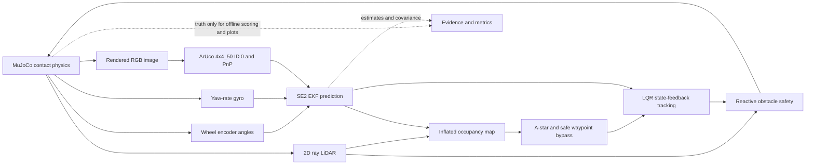

# TurtleBot3: estimated-state visual waypoint navigation and ArUco docking

**UTS 42043 / 41014 — Sensors and Control Integrated Project · Assessment 4 · Track A**  
**Validated simulation baseline: `configs/mujoco_v19_precision_trial.yaml`**  
**Status:** MuJoCo simulation validated across 15 recorded trials; **physical TurtleBot3 NOT tested**.

> **Measured evidence, not a hardware claim.** In the committed v0.19 MuJoCo archive, 15/15 runs completed the task under the simulator's acceptance criterion **and** met the stricter 0.18 m / 0.18 rad docking-pose requirements, with zero reported collisions. Results apply only to five scenarios × seeds 0–2, with the specified simulated geometry, tuning and disturbances. A reported success rate of 100% in 15 trials does not guarantee perfect reliability elsewhere.

## Watch and verify

- **[Final v0.19 technical results and failure analysis](docs/FINAL_VALIDATION_V19.md)**
- **[15-trial archived evidence](results/mujoco/robustness_v19_strict_15of15/)** — `aggregate.json`, `audit_v16.csv` / `.json`, per-trial configs/plots/trajectories/summaries, SHA-256 `manifest.json`
- **[Archived nominal MuJoCo video](results/mujoco/nominal_v13_seed7_success/demo_capture.mp4)** — earlier validated baseline, **not** the final v0.19 configuration
- **[Archived blocked MuJoCo video](results/mujoco/blocked_v18_seed0_success/demo_capture.mp4)** — earlier camera-assisted blocked result, **not** the final v0.19 configuration
- **[Five-minute v0.19 demo production plan](docs/DEMO_FIVE_MINUTE_PLAN.md)** — generate and archive final-configuration MP4s and produce a five-minute edited video; provide the completed video link in the final submission
- **[Hardware preparation and limitations](docs/HARDWARE_READINESS_V19.md)** — ROS 2 interface exists but real-robot operation has not been demonstrated
- **[Watch the Final 5-Minute Demonstration (YouTube)](https://youtu.be/iJr2u0MG8AM)** — Narrated MuJoCo demonstration of TurtleBot3 autonomous navigation, including nominal and blocked scenarios, A* path planning, EKF state estimation, LQR control, LiDAR obstacle detection, ArUco docking, and quantitative results. Duration: 4 minutes 31 seconds. Simulation only; physical hardware not tested.

### Summary from 15 actual MuJoCo runs

| Scenario | Simulator success | Strict pose pass | Mean final XY error | Reported collisions |
|---|---:|---:|---:|---:|
| Nominal | 3/3 | 3/3 | 0.1420 m | 0 |
| Encoder / camera sensor noise | 3/3 | 3/3 | 0.1369 m | 0 |
| Added blocking obstacle | 3/3 | 3/3 | 0.1539 m | 0 |
| Physical push / yaw disturbance | 3/3 | 3/3 | 0.1409 m | 0 |
| Increased camera dropout | 3/3 | 3/3 | 0.1421 m | 0 |
| **Overall** | **15/15** | **15/15** | **0.14316 m** | **0** |

The physical wrench was confirmed applied in all three disturbance trials; the blocked scenario safely bypassed unreachable **intermediate** waypoint 1 in all three runs. The overall mean XY estimation RMSE was **0.03806 m**. These numbers come from the suite and strict-pose audit, not from the offline kinematic test double.

## System, models and frames

**Task:** steer a TurtleBot3-like differential-drive robot through a LiDAR-mapped obstacle course; track waypoints using an estimated pose; detect ArUco ID 0 with a rendered front RGB camera; use camera range/bearing updates to an EKF; and dock near the charging marker.



The base pose is `x = [x, y, θ]ᵀ`, with planar differential-drive kinematics `ẋ=v cos θ`, `ẏ=v sin θ`, `θ̇=ω`; `v=r(φ̇_R+φ̇_L)/2`, `ω=r(φ̇_R−φ̇_L)/b`. The body-frame tracking-error dynamics are locally linearised as `ė=Ae+Bδu`, with `δu = −Ke` from a discrete-time LQR design. With nonzero forward reference speed, the locally linearised `(A,B)` controllability rank is 3; at zero reference speed it drops to 2. This is **local linearised** rank, not global manoeuvrability.

The camera measures range and bearing to an ArUco marker whose surveyed simulation world position is known. A single stationary 2-component measurement is insufficient to determine all three planar state variables; the stacked local observability rank can reach 3 during nonzero-speed motion. The EKF propagates encoder-based odometry (with optional gyro information) and corrects on accepted camera measurements. Its output, **not simulator truth**, drives mapping and control.

**Frame chain:** `world → base_link → camera optical` and `world → fixed marker`. Simulation assumes `base_link` x-forward/y-left/z-up; image optical x-right/y-down/z-forward; a configurable camera offset of 0.105 m. The LiDAR is modelled in the robot frame. Hardware transforms **must** be measured separately; the simulation transforms are not calibration certificates.

[Model equations, frame conventions and EKF derivation](docs/MODEL_AND_DESIGN.md) · [control/observability rank script](scripts/analyse_model.py)

## Installation on a fresh Linux / GitHub Codespace

Python **3.11** was used in the validated Codespace. Linux with OSMesa support is recommended for headless rendering. The repository provides `.devcontainer/` and `pyproject.toml`.

```bash
python3 -m venv .venv
source .venv/bin/activate
python -m pip install --upgrade pip
python -m pip install -e '.[test]'
export MUJOCO_GL=osmesa
export MPLBACKEND=Agg
python -m pytest -q
python scripts/verify_archive.py results
python scripts/submission_preflight.py
```

For a first checkout, start by running the tests and archive verification. Then reproduce the validated physics scenario:

```bash
python -m turtlebot_integrated.cli run --backend mujoco --scenario nominal --seed 0 \
  --config configs/mujoco_v19_precision_trial.yaml --video \
  --out outputs/recheck_nominal_v19
cat outputs/recheck_nominal_v19/summary.json
```

Reproduce the full set (**15 physics runs; allow appropriate compute time**):

```bash
python -m turtlebot_integrated.cli suite --backend mujoco --seeds 3 \
  --config configs/mujoco_v19_precision_trial.yaml --out outputs/recheck_suite_v19
python scripts/review_robustness_v16.py outputs/recheck_suite_v19
```

If the audit asks for `config_snapshot.json`, ensure the suite's top-level config exists in the new output (the current code writes this automatically). For strict, revision-specific comparisons consult the Git revision in the archive's `suite_metadata.json`; a fresh run against updated code may give different floating-point results. Results are written in ignored `outputs/`. **Do not overwrite** the committed archive under `results/`.

## Design decisions and failure-driven corrections

1. The earlier unsupported chassis pitched approximately **30°**, causing MuJoCo LiDAR rays to intersect the floor and produce spurious obstacle maps. An **optional simplified passive front support** was introduced; the controlled diagnostic reduced the 95th-percentile pitch from 29.92° to 1.50°. This support is not asserted to reproduce the exact TurtleBot3 chassis or caster.
2. Under the revised contact model, encoder odometry was re-calibrated using a 0.0330 m effective odometry radius. This is **simulation-specific**, not a hardware wheel-radius measurement.
3. A blocked intermediate waypoint lay within the 0.16 m map inflation distance of a new obstacle. A bounded A* bypass now permits skipping that intermediate point **only if** the next intermediate point is safely reachable; the final dock is never skipped.
4. MuJoCo's **rangefinder visualisation** was drawing yellow lines across the camera image and interfering with ArUco decoding. Hiding only the visualisation (not the actual range sensors) restored camera observations in the blocked scenario.
5. A final estimate-side stop margin (0.04 m, 0.035 rad) was added to account for residual EKF error. **True-pose strict assessment thresholds remain at 0.18 m / 0.18 rad**. Strict passes increased from 7/15 (v0.18) to 15/15 (v0.19) under the same 15-scenario/seed combinations.

See the [detailed evidence and limitations](docs/FINAL_VALIDATION_V19.md). These are controlled software/simulation findings, not proof of successful real-world deployment.

## Repository guide

| Location | Contents |
|---|---|
| `turtlebot_integrated/` | Robot dynamics backend, camera, EKF, A*, controller and ROS 2 adapter |
| `configs/mujoco_v19_precision_trial.yaml` | Frozen final validation parameters |
| `tests/` | Offline and MuJoCo-dependent regression tests |
| `scripts/submission_preflight.py` | Read-only audit of archived 15-trial evidence, hashes and submission files |
| `results/mujoco/` | Verified, committed evidence and demonstration clips |
| `outputs/` | Ignored temporary trials, diagnostics and new recordings |
| `docs/` | Engineering derivations, quantitative analysis, video storyboard, hardware caveats |

Run `python scripts/submission_preflight.py --strict` **after archiving the two final v0.19 demonstration MP4s**. It verifies evidence integrity and key deliverables but cannot judge a video, validate ROS 2 hardware or replace instructor assessment.

## Lab interface — not a completed hardware implementation

`turtlebot_integrated/ros2_bridge.py` is a **ROS 2 interface scaffold** that subscribes to encoders, scan, camera and optional IMU and publishes Twist. It starts in a zero-motion dry-run state unless `--enable-motion` is explicitly set. Topics, TF transforms, wheel joint names/signs, camera intrinsics, marker geometry and emergency-stop arrangements **have not been physically verified**. Do not enable motion until an authorised laboratory supervisor approves all checks in [the hardware runbook](docs/HARDWARE_RUNBOOK.md). The real robot is optional under the rubric; do not describe this adapter as real-hardware success.

## Assessment deliverables, contributions and AI transparency

**Assessment:** Submit via Canvas the GitHub project-page URL and **edited five-minute demonstration video** showing nominal completion, at least one varied/disturbed trial, and **state estimate with uncertainty alongside true state**. A viva voce follows; marks are subject to the viva moderation factor. Verify current course announcements and deadline. See [submission checklist](docs/SUBMISSION_CHECKLIST_V19.md).

**Contribution declaration (single-student project):** One student undertook requirements analysis, system architecture, integration decisions, experiment execution, troubleshooting, evaluation and evidence preparation. The student is responsible for understanding and defending every submitted component. This statement should be amended if collaborators contributed.

**Generative AI use declaration:** ChatGPT (OpenAI) was used to discuss architecture, generate and revise Python code, tests, diagnostic scripts, documentation drafts, and interpret user-run experiments. Experimental metrics are drawn from the run artifacts generated in GitHub Codespaces. The student reviewed, integrated and tested the proposed changes; claims are limited to the recorded evidence. Do not claim personally authored every line of generated code or that hardware was tested. Record any additional tools or third-party tutorials actually used.

**Academic scope:** Track A; compulsory MuJoCo component completed for the 15 reported tests. Hardware is optional, not substituted for simulation. Additional engineering claims and the user's ability to explain the work should be assessed on their merits, not inferred from the percentage of successful trials.
